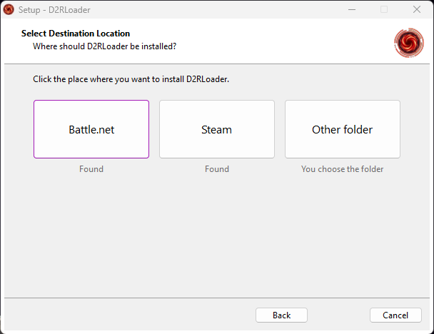

# D2RLoader Installer

The Windows installer for [D2RLoader](https://d2rloader.net), a loader for Diablo II: Resurrected. D2RLoader adds features such as TCP/IP multiplayer, an in-game mod selector, plugins, and automatic backups.



The installer finds your copy of the game, downloads the D2RLoader files, checks every file, and installs them. Run it again to update D2RLoader, or to remove it.

**Download:** [d2rloader.net/download.html](https://d2rloader.net/download.html)

This repository contains the installer only. D2RLoader itself is closed source. The installer downloads its compiled files and contains none of its code.

## What it does

- **Finds the game.** It looks for the Battle.net and the Steam version of Diablo II: Resurrected. A folder counts only if it contains `D2R.exe`. If it finds nothing, or you use another folder, you can choose one.
- **Installs and updates.** It downloads only the files that are new or changed, and it repairs files that are damaged or missing. Your settings in `d2rloader.toml` are never replaced.
- **Uninstalls.** It removes the files that it installed and keeps everything else. Your settings stay unless you ask to remove them. Your mods, plugins, and saved data are never removed.
- **Handles more than one copy of the game.** Run it once for each copy, for example for Battle.net and for Steam.
- **Speaks the languages of the game:** English, German, Spanish, French, Italian, Japanese, Korean, Polish, Brazilian Portuguese, Russian, and Chinese (simplified and traditional). The translations are drafts. Corrections are welcome, see [docs/translations.md](docs/translations.md).

## How it protects what it installs

The installer does not contain the D2RLoader files. It reads a manifest from d2rloader.net that lists every file of the current release, with its install path, download address, size, and SHA-256 hash. The format is in [docs/manifest.md](docs/manifest.md). Then:

1. It checks the manifest. Addresses must use HTTPS. A path cannot leave the game folder: `..`, drive letters, backslashes, and alternate data streams are refused. One broken rule rejects the whole manifest.
2. It downloads each file into a temporary folder and checks its size and SHA-256 hash. A file that does not match is removed and the installation stops. The game folder has not changed at this point.
3. Only when every file has passed does it copy the files into the game folder. If a copy fails, for example because a program has the file open, it puts back the files that it already copied.
4. It does not install while `D2RLoader.exe` runs from the same folder. It asks you to close it first.

A hash that comes from the same website as the file protects against damaged downloads. It does not protect against someone who controls the website. For that, the plan is to sign the manifest and check the signature with a public key inside the installer.

## What it changes on your PC

| Where | What |
| --- | --- |
| The game folder | `D2RLoader.exe`, `D2RCore.dll`, `d2rloader.mpq`, a default `d2rloader/config/d2rloader.toml`, and empty folders for mods, plugins, data, logs, and crash reports. It does not change `D2R.exe` or any other game file. |
| `C:\Program Files (x86)\D2RLoader\Installer\<id>\` | The uninstaller and its record of the installed files. Only administrators can write to this folder. |
| Start menu and desktop | A shortcut, only if you choose one. |
| Installed apps | One entry named "D2RLoader". |

To find the game, the installer reads the Battle.net and Steam entries in the registry and Steam's `libraryfolders.vdf`. To see whether D2RLoader is running, it asks Windows (WMI) for the running programs by file name. It reads nothing else, and it sends none of this information anywhere.

The installer asks for administrator rights, because the usual Battle.net folder is under `C:\Program Files (x86)`. [docs/how-it-works.md](docs/how-it-works.md) explains the install and uninstall steps, and the command line options.

## Privacy

The installer connects only to d2rloader.net, over HTTPS, to get the manifest and the files. It sends no data about your PC or your game, and it has no telemetry. Like any web server, d2rloader.net can log the address of the PC, the time, and the request. The [privacy policy](https://d2rloader.net/privacy) of the website describes this.

## Code signing policy

The installer and its uninstaller are signed with the project's own certificate (`CN=D2RLoader`), the same certificate that signs `D2RLoader.exe`. It is not from a public certificate authority, so Windows can show an "unknown publisher" or SmartScreen warning. The download page shows the SHA-256 hash and the certificate thumbprint of the installer, so you can check your download.

We plan to move to free code signing for open source projects from the [SignPath Foundation](https://signpath.org). With that, GitHub Actions would build the installer from this repository, and a signing request would need the maintainer's approval for each release. This section will then say so. Until then, the installer is built and signed on the maintainer's PC with `tools/build.py` (see [docs/releasing.md](docs/releasing.md)).

Dimentio maintains the project and approves each release. The code was written with AI assistance, under the direction of the maintainer. Automated tests cover the installer (see [docs/development.md](docs/development.md#tests)), and anyone can review the source. The D2RLoader GitHub organization requires two-factor authentication for all members.

## Build from source

You need [Inno Setup 7](https://jrsoftware.org/isinfo.php). Then run:

```
ISCC src\installer.iss
```

The installer is `out\D2RLoader-Installer.exe`, and it is not signed. `build-installer.cmd` does the same and signs the installer when the certificate is in the Windows certificate store.

The tests need Python 3 as well. Run `run-tests.cmd`, or `python -I tests/run-all.py`. They include end-to-end tests that run the real installer against a local web server and a fake game folder. See [docs/development.md](docs/development.md).

## Documentation

- [How it works](docs/how-it-works.md): finding the game, installing, the uninstaller, and the command line.
- [Manifest format](docs/manifest.md): the rules that the installer enforces.
- [Translations](docs/translations.md): how to edit or add a language.
- [Development](docs/development.md): folders, tests, and the test build.
- [Releasing](docs/releasing.md): how the maintainer publishes a release.

## Trademarks

Diablo is a trademark or registered trademark of Blizzard Entertainment, Inc., in the U.S. and/or other countries. Battle.net is a trademark of Blizzard Entertainment, Inc. Steam is a trademark of Valve Corporation.

The installer uses these names only to say which version of the game it works with. It does not use their logos. D2RLoader and this installer have no connection with Blizzard Entertainment or Valve, and these companies do not endorse them.

## License

The installer code is under the GNU General Public License, version 3. See [LICENSE](LICENSE). The license does not cover D2RLoader or Diablo II: Resurrected. It also does not cover the D2RLoader logo and the pictures made from it (the folder `assets`, and the screenshots in `docs/images`). See [assets/NOTICE.md](assets/NOTICE.md).
