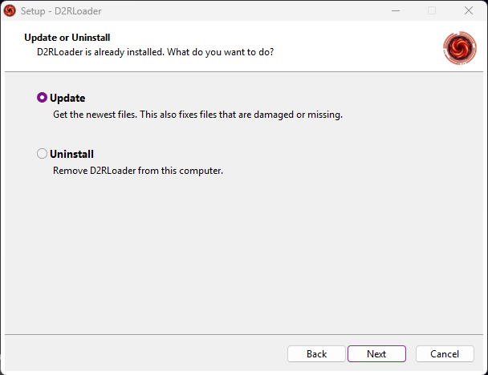
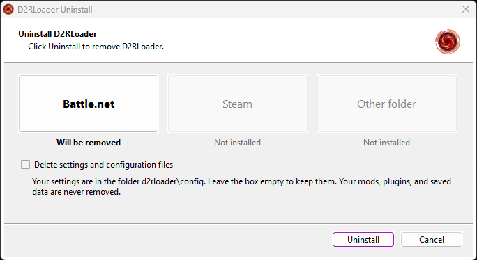

# How it works

The [README](../README.md) has the overview. This page has the details of each step.

## Finding the game

Setup looks for two kinds of install:

- **Battle.net.** The Battle.net app writes an uninstall entry for Diablo II: Resurrected in the registry. Setup reads the install location from it.
- **Steam.** Setup reads the Steam folder from the registry. Then it reads `steamapps\libraryfolders.vdf` to find every Steam library, and looks for the game in each one.

A folder counts only if `D2R.exe` is in it. The page "Select Destination Location" shows one button for each kind: "Battle.net", "Steam", and "Other folder". A button is grey when Setup did not find that install. "Other folder" lets you pick a folder. Setup checks that one for `D2R.exe` too.


## Installing and updating

1. Setup downloads the manifest and checks it (see [manifest.md](manifest.md)).
2. For each file in the manifest, it decides if the file is needed. A file is skipped when the same file (same SHA-256) is already in the game folder. A file marked `onlyIfMissing`, such as `d2rloader.toml`, is written only when it does not exist.
3. It downloads the needed files into a temporary folder, and checks the size and SHA-256 of each one.
4. Only after every download has passed, it copies all the files into the game folder. It uses the standard Inno Setup file copy, so Inno Setup records each file for the uninstaller. It copies the up-to-date files too, so the uninstaller also knows files that you unpacked by hand from the ZIP.
5. If a file cannot be replaced, Setup retries for a few seconds. Then it stops and puts back the files that it copied in this run.

When D2RLoader is already installed, Setup first asks whether to update or uninstall. "Update" also repairs files that are damaged or missing, so there is no separate "Repair".



## The uninstaller

Each install has its own uninstaller. It is not in the game folder. It is in `C:\Program Files (x86)\D2RLoader\Installer\<id>\`, together with the record of the installed files. Only an administrator can write there, so a standard user cannot put a program in that folder for the uninstaller of an administrator to start.

`<id>` is 12 hexadecimal characters taken from the SHA-256 hash of the game folder path (in lower case). So each game folder has its own folder, with a small `install.txt` that has two lines: the kind (`Battle.net`, `Steam`, or `Custom`) and the game folder. Every uninstaller reads the `install.txt` files next to it, so one uninstaller can list all installs and remove any of them. The list of installed apps in Windows shows one entry, for the most recent install.



The uninstaller:

- Removes the files that Setup installed, and the shortcuts. It does this even if you changed a file. The settings are the exception.
- Removes the folders that Setup made, if they are empty.
- Keeps your settings in `d2rloader\config`. The box "Delete settings and configuration files" is empty by default, and you can tick it to remove the settings too.
- Never removes your mods, plugins, or saved data.
- Stops while `D2RLoader.exe` runs from that folder.

A file that a later release no longer lists stays in the game folder after an update. Setup does not remove it, and the uninstaller does not know it.

## Command line

Setup accepts the standard [Inno Setup command line options](https://jrsoftware.org/ishelp/index.php?topic=setupcmdline), for example:

```
D2RLoader-Installer.exe /VERYSILENT /DIR="D:\Games\Diablo II Resurrected"
D2RLoader-Installer.exe /CURRENTUSER /LANG=german
```

- `/DIR=<folder>` installs into that folder. Setup still checks for `D2R.exe`.
- `/CURRENTUSER` runs without administrator rights. This works when the game folder is yours to write to.
- `/LANG=<language>` chooses the language, for example `german` or `chinesesimplified`.
- `/LOG=<file>` writes a log.

Silent uninstall: run the uninstaller of the install with `/VERYSILENT`. It removes that install and keeps the settings. Add `/RemoveSettings=1` to delete the settings too.
